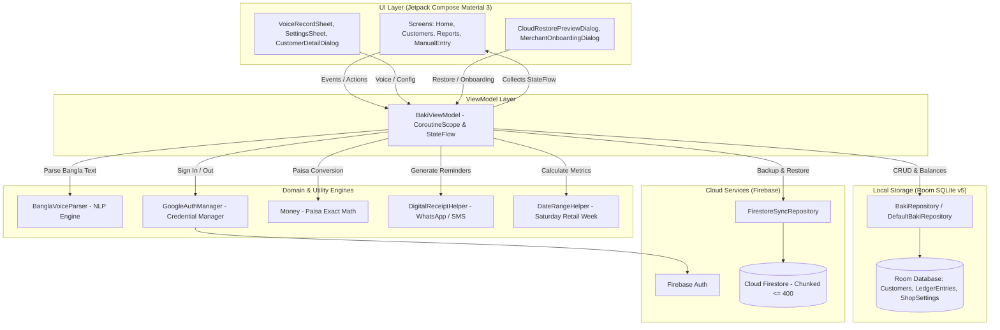

# 🇧🇩 Baki Bondhu (বাকী বন্ধু)
### **Voice-First Smart Credit & Debit Ledger for Bangladeshi Retailers**

<p align="center">
  
  
  
  
  
  
  
  
</p>

---

> **Core Product Promise**:  
> **"আপনার দোকানের হিসাব, এখন শুধু মুখে বললেই।"**  
> *(Your shop's ledger, simply by speaking.)*

**Baki Bondhu (বাকী বন্ধু)** is an intelligent, offline-first digital ledger application designed and engineered specifically for Bangladeshi neighborhood shopkeepers (*মুদির দোকান*, tea stalls, small pharmacies, wholesale suppliers, and retail merchants). It transforms traditional red paper ledgers (*লাল খাতা*) into an effortless, voice-enabled financial tool that works without internet connection and protects every single paisa with zero-drift integer arithmetic.

---

## 📑 Table of Contents

- [Key Highlights & Product Pillars](#-key-highlights--product-pillars)
- [Architecture & Tech Stack](#-architecture--tech-stack)
- [Financial Precision & Minor Units](#-financial-precision--minor-units)
- [Voice-First Bengali NLP Engine](#-voice-first-bengali-nlp-engine)
- [Cloud Synchronization & Conflict Safety](#-cloud-synchronization--conflict-safety)
- [Comprehensive Technical Documentation](#-comprehensive-technical-documentation)
- [Project Structure](#-project-structure)
- [Setup & Build Instructions](#-setup--build-instructions)
- [Engineering Credits & Attribution](#-engineering-credits--attribution)

---

## 🌟 Key Highlights & Product Pillars

### 🎙️ 1. Natural Bengali Voice Ledger (*ভয়েস খাতা*)
- **Colloquial Dialect Support**: Recognizes informal everyday phrasing: *"করিম সাহেব বাকী নিলেন ৫০০ টাকা"*, *"রহিম জমা দিলেন ২০০"*, *"সুমন পাঁচশো পরিশোধ"*, *"নগদ বিক্রি ১,২০০ টাকা"*.
- **Spoken Word & Numeral Parsing**: Parses digits (`৪৫০`, `1250`) and verbal expressions (*এক হাজার*, *পাঁচশো*, *দেড় হাজার*, *আড়াই হাজার*).
- **Zero-Amount Hallucination Guard**: Never guesses or defaults to zero when no monetary value is spoken. The app alerts the merchant and prompts for clarification before committing to the ledger.
- **Audio Readback Confirmation**: Optional Bengali voice synthesis confirms recorded transactions aloud to reassure busy shopkeepers.

### 🛡️ 2. Minor Currency Precision ($1\text{ BDT} = 100\text{ Paisa}$)
- All customer balances and ledger entries are stored as **integer 64-bit numbers (`Long`)** in **Paisa**, completely eliminating IEEE 754 floating-point drift.
- Bilingual formatting with immutable non-breaking spaces (`৳\u00A0১,২৫০`), preventing awkward line wraps between currency symbols and amounts.

### 📶 3. 100% Offline-First (Room SQLite v5)
- Fully operational without internet connectivity. Customers can be created, credit recorded, repayments entered, and daily reports generated while offline.
- Data is written via atomic Room `@Transaction` methods; soft-delete tombstones (`isDeleted`) allow safe two-way cloud reconciliation.

### 🔐 4. Modern Google Sign-In & Guest Mode
- Powered by the **Android Credential Manager API** (`androidx.credentials`) with Google Identity Services.
- **First-Class Guest Mode**: Shopkeepers are never forced to sign in. The entire app is accessible immediately on install; Google Sign-In is only needed for cloud backup.

### ☁️ 5. Zero-Trust Cloud Backup & Pre-Restore Preview
- Backs up customer and transaction records to **Google Cloud Firestore** under strict per-user paths (`/users/{userId}/...`).
- **Batch Chunking**: Writes are chunked in safe blocks of 400 operations, comfortably under Firestore's 500-operation quota limit.
- **Cloud Restore Preview**: Side-by-side modal displaying local vs. cloud counts with **Smart Merge** (non-destructive) or **Full Replace** options.

### 📊 6. Comprehensive 11-Metric Financial Dashboard & Daily Closing
- Computed directly from SQLite Room database with **Saturday-aligned commercial retail cycles** (traditional Bangladeshi business week).
- Cash Drawer Reconciliation:
  $$\text{Net Cash in Drawer} = \text{Today's Repayments} + \text{Today's Cash Sales}$$
  $$\text{Net Credit Change} = \text{Today's Credit Sales} - \text{Today's Repayments}$$

### 📲 7. 1-Tap WhatsApp & SMS Payment Reminders
- Formats culturally respectful Bengali payment reminders with:
  - Customer name & total outstanding balance
  - Shop name & owner phone number
  - bKash & Nagad "Send Money" instructions
- Deep-links directly to WhatsApp with automated phone normalization (`88017...`).

---

## 🏗️ Architecture & Tech Stack



| Component | Technology | Version / Specification |
| :--- | :--- | :--- |
| **Language** | Kotlin | `2.0.21` |
| **UI Framework** | Jetpack Compose + Material 3 Expressive | `1.7.5` / `1.3.1` |
| **Local Database** | AndroidX Room | `2.6.1` (Schema Version `5`) |
| **Asynchronous Engine**| Kotlin Coroutines & StateFlow | `1.9.0` |
| **Authentication** | Jetpack Credential Manager + Google ID | `1.3.0` / `1.1.1` |
| **Cloud Storage** | Google Cloud Firestore | Firebase BOM `33.5.1` |
| **Voice Processing** | Android SpeechRecognizer + Bangla NLP | On-Device / Native |
| **Target Platforms** | Android 8.0 (API 26) through Android 15 (API 35/36) | |

---

## 💰 Financial Precision & Minor Units

In typical retail accounting, floating-point numbers (`Float`, `Double`) cause cumulative rounding errors. Baki Bondhu guarantees absolute financial integrity using integer minor units:

```kotlin
// Example: Converting BDT to Minor Units
val debt = Money.fromBdt(1250.50) // Exact: 125050L Paisa
val repayment = Money.fromBdt(250.00) // Exact: 25000L Paisa
val remaining = debt - repayment // Exact: 100050L Paisa ($1000.50 BDT)

// Formatting with non-breaking space
println(remaining.format(isBn = true))  // "৳ ১২৫০.৫০"
println(remaining.format(isBn = false)) // "৳ 1,250.50"
```

---

## 🎙️ Voice-First Bengali NLP Engine

Shopkeepers can speak naturally into their phone. The parser handles common Bengali grammatical suffixes, spoken digits, and verbal numbers:

| Spoken Bengali Input | Parsed Entity | Amount | Transaction Type |
| :--- | :--- | :--- | :--- |
| *"রহিম ৪৫০ বাকী"* | Rahim | ৳ 450 | `BAKI_SALE` (বাকি বিক্রি) |
| *"করিম ভাই ২০০ টাকা জমা"* | Karim Bhai | ৳ 200 | `REPAYMENT` (জমা আদায়) |
| *"সুমন পাঁচশো পরিশোধ"* | Sumon | ৳ 500 | `REPAYMENT` (জমা আদায়) |
| *"সালাম দেড় হাজার বাকি"* | Salam | ৳ 1,500 | `BAKI_SALE` (বাকি বিক্রি) |
| *"নগদ বিক্রি ৮০০ টাকা"* | Cash Customer | ৳ 800 | `CASH_SALE` (নগদ বিক্রি) |
| *"কামাল বাকি"* | Kamal | *Flagged Missing* | Prompts for amount |

---

## 📚 Comprehensive Technical Documentation

Explore the in-depth technical guides authored in the [`docs/`](docs/) directory:

- 🏛️ [**Architecture Guide**](docs/ARCHITECTURE.md): Architectural design, MVVM patterns, reactive StateFlow lifecycle, and offline-first data flows.
- 🗄️ [**Database Architecture**](docs/DATABASE.md): Room schema v5, minor unit Paisa precision, `MIGRATION_4_5` SQL operations, foreign key integrity, and index designs.
- 🔑 [**Authentication Guide**](docs/AUTHENTICATION.md): Modern Credential Manager integration, Google Sign-In setup, Activity context unwrapping, and Guest mode fallback.
- 🔄 [**Synchronization & Conflict Resolution**](docs/SYNCHRONIZATION.md): Chunked Firestore batch writes (400 items), pre-restore safety inspection, Smart Merge vs. Full Replace.
- 🎨 [**Design System & Bengali UX Tokens**](docs/DESIGN_SYSTEM.md): "Modern Bengali Ledger" aesthetic tokens, color palettes, tabular digits, and retail touch ergonomics.
- 🧪 [**QA & Automated Testing**](docs/QA_AND_TESTING.md): Pure JVM tests, migration test cases, Robolectric testing, and quality assurance strategies.

---

## 📁 Project Structure

```
├── app/
│   ├── src/
│   │   ├── main/
│   │   │   ├── java/com/example/
│   │   │   │   ├── MainActivity.kt               # Root Activity, Inset handling, Scaffold & Nav
│   │   │   │   ├── auth/
│   │   │   │   │   └── GoogleAuthManager.kt      # Credential Manager + Google Auth
│   │   │   │   ├── data/
│   │   │   │   │   ├── cloud/
│   │   │   │   │   │   └── FirestoreSyncRepository.kt # Safe chunked Firestore sync & preview
│   │   │   │   │   ├── local/
│   │   │   │   │   │   ├── AppDatabase.kt        # Room DB v5 with registered migrations
│   │   │   │   │   │   ├── DatabaseMigrations.kt # MIGRATION_4_5 non-destructive upgrade
│   │   │   │   │   │   ├── CustomerDao.kt        # Customer queries & atomic Paisa balance
│   │   │   │   │   │   ├── TransactionDao.kt     # Ledger queries, soft deletes & ranges
│   │   │   │   │   │   └── ShopSettingsDao.kt    # Merchant profile & payment configs
│   │   │   │   │   ├── model/
│   │   │   │   │   │   ├── Customer.kt           # Customer entity with Paisa & UUID
│   │   │   │   │   │   ├── Transaction.kt        # Ledger entry entity with tombstone
│   │   │   │   │   │   └── ShopSettingsEntity.kt # Shop settings schema
│   │   │   │   │   └── repository/
│   │   │   │   │       ├── BakiRepository.kt     # Atomic repository contract
│   │   │   │   │       └── DefaultBakiRepository.kt # Reactive implementation
│   │   │   │   ├── ui/
│   │   │   │   │   ├── BakiViewModel.kt          # UI state, coroutines, voice & sync coordinator
│   │   │   │   │   ├── BakiStrings.kt            # Bengali/English localization strings
│   │   │   │   │   ├── components/               # Reusable UI widgets & sheets
│   │   │   │   │   │   ├── CloudRestorePreviewDialog.kt # Safe pre-restore inspection modal
│   │   │   │   │   │   ├── MerchantOnboardingDialog.kt  # First-run setup wizard
│   │   │   │   │   │   ├── SettingsSheet.kt             # Cloud sync & payment configuration
│   │   │   │   │   │   ├── VoiceRecordSheet.kt          # Audio oscilloscope & voice review
│   │   │   │   │   │   ├── CustomerDetailDialog.kt      # Ledger detail & WhatsApp reminders
│   │   │   │   │   │   ├── EndOfDaySummaryDialog.kt     # Daily cash drawer reconciliation
│   │   │   │   │   │   └── DigitalReceiptDialog.kt      # Itemized receipt generator
│   │   │   │   │   ├── screens/                  # Primary application screens
│   │   │   │   │   │   ├── HomeScreen.kt         # Ledger overview & recent activity
│   │   │   │   │   │   ├── CustomersScreen.kt    # Customer catalog & debt status
│   │   │   │   │   │   ├── ReportsScreen.kt      # 11 financial metrics & weekly analysis
│   │   │   │   │   │   └── ManualEntryScreen.kt  # Fallback manual transaction entry
│   │   │   │   │   └── theme/
│   │   │   │   │       ├── Color.kt              # Emerald Bengali Green color tokens
│   │   │   │   │       ├── Theme.kt              # Material 3 dynamic color scheme
│   │   │   │   │       └── Type.kt               # Bengali typography & tabular digits
│   │   │   │   ├── util/
│   │   │   │   │   ├── Money.kt                  # Minor currency unit (Paisa) math engine
│   │   │   │   │   ├── DateRangeHelper.kt        # Saturday-aligned retail week ranges
│   │   │   │   │   ├── DigitalReceiptHelper.kt   # WhatsApp & SMS reminder formatting
│   │   │   │   │   └── OverdueHelper.kt          # Aging tiers & overdue calculations
│   │   │   │   └── voice/
│   │   │   │       ├── BanglaVoiceParser.kt      # NLP voice parser with digit extraction
│   │   │   │       └── BanglaVoiceManager.kt     # Speech recognition controller
│   │   │   └── res/                              # Drawables, layouts, localized strings
│   │   └── test/java/com/example/                # Automated JUnit & Robolectric test suite
│   │       ├── MoneyTest.kt                      # Paisa math & formatting tests
│   │       ├── BanglaVoiceParserTest.kt          # Bengali NLP & dialect tests
│   │       ├── DatabaseMigrationTest.kt          # SQLite v4 to v5 non-destructive tests
│   │       ├── ExampleUnitTest.kt                # Utility & SMS tests
│   │       └── ExampleRobolectricTest.kt         # Room DAOs, ViewModels & Helpers
│   └── build.gradle.kts                          # App build configuration & dependencies
├── docs/                                         # Technical documentation suite
├── firestore.rules                               # Zero-trust Firestore security rules
└── README.md                                     # Root project documentation
```

---

## 🚀 Setup & Build Instructions

### Prerequisites
- **Android Studio Ladybug (2024.2.1+)** or higher
- **JDK 17** (configured as Gradle JVM)
- **Android SDK API 35/36** with Build-Tools `35.0.0`
- Optional: Google Play Services device or emulator for testing Google Sign-In

### Clone & Build
```bash
# 1. Clone repository
git clone https://github.com/beingmushfiq/Baki-Bondhu.git
cd Baki-Bondhu

# 2. Build Debug APK
./gradlew assembleDebug

# 3. Run Unit and Migration Tests
./gradlew testDebugUnitTest
```

The compiled APK will be generated at:
`app/build/outputs/apk/debug/app-debug.apk`

---

## 👨‍💻 Engineering Credits & Attribution

- **Product & Engineering**: Developed and maintained by **DevCenterPoint** ([devcenterpoint.com](https://devcenterpoint.com)).
- **App Nickname**: `com.dcp.bakibondhu`
- **Application ID**: `com.aistudio.bakibondhu.kxdznp`
- **License**: Released under the [MIT License](LICENSE).
