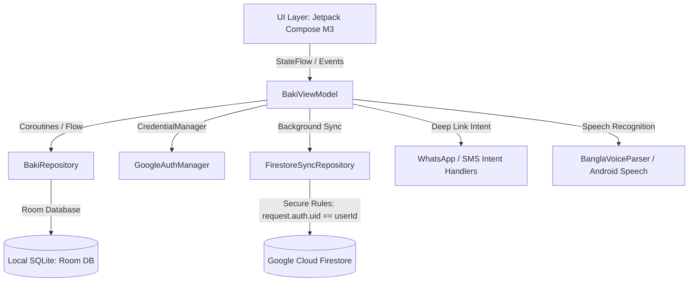

# 🇧🇩 Baki Bondhu (বাকী বন্ধু)
### **Voice-First Smart Credit & Debit Ledger for Bangladesh Retailers**

<p align="center">
  
  
  
  
  
  
  
</p>

---

## 📖 Overview

**Baki Bondhu (বাকী বন্ধু)** is an intelligent, offline-first digital ledger tailored specifically for Bangladeshi shopkeepers (*Mudi Dokan*, pharmacies, tea stalls, wholesalers, and small businesses). It replaces physical paper ledger notebooks (*খাতা*) with an effortless, voice-enabled experience. 

With **Baki Bondhu**, shop owners simply speak in natural colloquial Bangla (*"করিম সাহেব বাকী নিলেন ৫০০ টাকা"* or *"রহিম জমা দিলেন ২০০"*), and the app automatically parses the customer name, amount, and transaction type to log it in real-time. Customer debt records can be backed up automatically to their personal **Google Account** via **Cloud Firestore**, and reminders can be sent directly to customers with **1-tap WhatsApp deep-linking** featuring bKash & Nagad payment numbers.

---

## ✨ Key Features

### 🎙️ 1. Native Bangla Voice Input (*ভয়েস খাতা*)
- **Colloquial NLP Parsing**: Speaks natural Bangla dialects. Recognizes terms like *বাকী*, *দিলেন*, *নিলেন*, *জমা*, *পরিশোধ*, *ধার*, *নগদ বিক্রি*.
- **Bangla Numeral & Word Extraction**: Converts English or Bangla numerals (*১২০*, *৫০০*, *১,২০০*) and conversational number words (*পাঁচশো*, *দেড় হাজার*, *বিশ টাকা*) into exact transaction amounts.
- **Instant Audio Feedback & Audio Readback**: Optional Bengali voice confirmation reads back recorded transactions to build confidence for non-tech-savvy merchants.
- **Smart Entity Disambiguation**: Matches spoken names against the existing customer contact list.

### 📲 2. Rapid WhatsApp 1-Tap Deep-Linking & SMS Reminders
- **Personalized Bangla Debt Summaries**: Formats polite, culturally respectful Bengali reminders containing:
  - Total outstanding debt balance (*মোট বকেয়া*)
  - Shop name & owner contact
  - bKash & Nagad Send Money details
  - Promised due date reminder
- **Direct WhatsApp Protocol (`whatsapp://send?phone=...`)**: Opens WhatsApp directly to the customer's chat with the message pre-filled.
- **SMS & Chooser Fallback**: Seamless fallback for customers without WhatsApp or internet connectivity.

### ☁️ 3. Google Sign-In & Zero-Trust Cloud Backup (Firebase Firestore)
- **Jetpack Credential Manager**: Frictionless one-tap Google Sign-In utilizing modern `GetSignInWithGoogleOption`.
- **Automatic & Manual Cloud Sync**:
  - **Auto-Backup**: Changes to customers or transactions are synchronized in the background whenever signed in.
  - **Manual Backup & Restore**: One-tap backup and restore allowing shopkeepers to switch phones without losing records.
- **Zero-Trust Security**: Cloud Firestore security rules strictly isolate records under `/users/{userId}/...` where `request.auth.uid == userId`. No cross-account leakage.

### 🧾 4. Digital Receipts Generator
- Generates itemized, shareable receipts featuring:
  - Shop branding & owner contact
  - Transaction date & time stamp
  - Previous balance, current transaction, and remaining balance
  - Merchant payment numbers (bKash / Nagad)
- Direct sharing to WhatsApp, SMS, or system share sheet.

### 📊 5. End-of-Day Cash Drawer Reconciliation & Reports
- **Daily Cash Summary**: Instant calculation of:
  - 💵 **Total Cash Received** (*মোট জমা*)
  - 📉 **Total Credit Disbursed** (*নতুন বাকী*)
  - ⚖️ **Net Daily Cash Flow** (*দিনের নিট ব্যালেন্স*)
- **Filtering System**: Date-range filtering (*Today*, *Yesterday*, *This Week*, *This Month*, *Custom Date Range*).
- **Search & Quick Actions**: Search by name or phone number with real-time balance calculations.

### 🌐 6. 100% Offline-First Architecture
- Full local SQLite persistence powered by **Android Jetpack Room**.
- Never stalls or fails when mobile data drops; queues changes locally and syncs when connectivity resumes.
- **Bilingual Interface**: One-tap toggle between **বাংলা (Bengali)** and **English**.

---

## 🏗️ Architecture & Technology Stack



| Layer | Technologies & Libraries |
| :--- | :--- |
| **Language & Toolchain** | **Kotlin 2.0.21**, Gradle Kotlin DSL (`.gradle.kts`), AGP 8.8.2 |
| **UI Framework** | **Jetpack Compose**, Material Design 3 (M3 Expressive), Edge-to-Edge |
| **State Management** | Android **ViewModel**, `MutableStateFlow`, `collectAsState` |
| **Local Persistence** | **Android Room 2.6.1**, SQLite, Dao coroutine queries |
| **Authentication** | **Jetpack Credential Manager**, Google Identity Services, Firebase Auth |
| **Cloud Database** | **Google Cloud Firestore**, Real-time collections, Zero-Trust Rules |
| **Voice & NLP** | Android SpeechRecognizer, Custom Regex Bangla Voice Grammar Engine |
| **External Integrations** | WhatsApp Deep Link URI (`whatsapp://send`), Android SMS Intents |
| **Testing** | Robolectric, Local JVM Unit Tests, Node.js Firebase Rules Tests |

---

## 🔒 Security & Data Privacy

Baki Bondhu is built with strict privacy controls for merchant financial data:

1. **User-Scoped Isolation**:
   ```javascript
   match /users/{userId} {
     allow read, write: if request.auth != null && request.auth.uid == userId;
     
     match /customers/{customerId} {
       allow read, write: if request.auth != null && request.auth.uid == userId;
     }
     
     match /transactions/{transactionId} {
       allow read, write: if request.auth != null && request.auth.uid == userId;
     }
   }
   ```
2. **Credential Safety**:
   - Web Client IDs are loaded dynamically via Android string resources (`R.string.default_web_client_id`), never hardcoded.
   - Database credentials are managed securely through Google Play Services.

---

## 📁 Project Structure

```
├── app/
│   ├── src/
│   │   ├── main/
│   │   │   ├── java/com/example/
│   │   │   │   ├── MainActivity.kt                  # Main Activity, Scaffold & TopAppBar
│   │   │   │   ├── auth/
│   │   │   │   │   └── GoogleAuthManager.kt         # Jetpack Credential Manager Sign-In
│   │   │   │   ├── data/
│   │   │   │   │   ├── cloud/
│   │   │   │   │   │   └── FirestoreSyncRepository.kt # Cloud Firestore backup & restore
│   │   │   │   │   ├── local/
│   │   │   │   │   │   ├── BakiDatabase.kt          # Room Database definition & TypeConverters
│   │   │   │   │   │   ├── CustomerDao.kt           # Customer DAO (batch inserts & queries)
│   │   │   │   │   │   └── TransactionDao.kt        # Transaction DAO & filtering
│   │   │   │   │   ├── model/
│   │   │   │   │   │   ├── Customer.kt              # Customer entity
│   │   │   │   │   │   ├── Transaction.kt           # Transaction entity & TransactionType
│   │   │   │   │   │   └── ShopSettingsEntity.kt    # Merchant profile & payment details
│   │   │   │   │   └── repository/
│   │   │   │   │       ├── BakiRepository.kt        # Repository abstraction
│   │   │   │   │       └── DefaultBakiRepository.kt # Reactive Room repository implementation
│   │   │   │   ├── ui/
│   │   │   │   │   ├── BakiViewModel.kt             # UI State, Voice, Auth & Sync flows
│   │   │   │   │   ├── BakiStrings.kt               # Comprehensive EN/BN Localization map
│   │   │   │   │   ├── components/
│   │   │   │   │   │   ├── SettingsSheet.kt         # Shop config & Google Cloud Backup UI
│   │   │   │   │   │   ├── CustomerDetailDialog.kt  # Account details & WhatsApp reminder
│   │   │   │   │   │   ├── VoiceRecordSheet.kt      # Voice input oscilloscope & feedback
│   │   │   │   │   │   ├── EndOfDaySummaryDialog.kt # Daily cash drawer reconciliation
│   │   │   │   │   │   ├── DigitalReceiptDialog.kt  # Shareable receipt generator
│   │   │   │   │   │   └── BakiToastHost.kt         # Floating snackbar & toast system
│   │   │   │   │   ├── screens/
│   │   │   │   │   │   ├── HomeScreen.kt            # Dashboard, Quick stats & Recent entries
│   │   │   │   │   │   ├── CustomersScreen.kt       # Customer ledger cards & debt badges
│   │   │   │   │   │   ├── ReportsScreen.kt         # Financial analytics & charts
│   │   │   │   │   │   └── ManualEntryScreen.kt     # Fallback manual transaction form
│   │   │   │   │   └── theme/
│   │   │   │   │       ├── Color.kt                 # Emerald Bengali Green Palette
│   │   │   │   │       └── Theme.kt                 # Material 3 Theme setup
│   │   │   │   └── voice/
│   │   │   │       ├── BanglaVoiceParser.kt         # Regex-based natural Bangla NLP parser
│   │   │   │       └── BanglaVoiceManager.kt        # Audio record & SpeechRecognizer lifecycle
│   │   │   └── res/
│   │   │       ├── drawable/                        # Vector assets (Logo, WhatsApp, Google)
│   │   │       └── values/                          # App strings, colors, firebase configs
│   ├── build.gradle.kts                             # App module Gradle configuration
├── firestore.rules                                  # Zero-trust Firestore security rules
├── firestore.test.js                                # Automated security rules test suite
├── firebase-blueprint.json                          # Backend schema blueprint
└── README.md                                        # Project documentation
```

---

## 🚀 Getting Started

### Prerequisites
- **Android Studio Ladybug (2024.2.1)** or newer
- **JDK 17** or **JDK 21**
- Android SDK with `minSdk = 26` and `targetSdk = 35`
- An Android device or emulator with Google Play Services installed

### Cloning and Building
1. Clone the repository:
   ```bash
   git clone https://github.com/your-username/baki-bondhu.git
   cd baki-bondhu
   ```
2. Open the project in **Android Studio**.
3. Let Gradle sync project dependencies.
4. Run the app on an Android device or emulator:
   ```bash
   ./gradlew assembleDebug
   ```

### Running Unit Tests
Execute the local JVM and Robolectric test suite:
```bash
./gradlew testDebugUnitTest
```

### Running Firestore Security Rules Tests
To test the Firestore zero-trust rules against the local Firebase emulator:
```bash
firebase emulators:exec --only firestore,auth "node --test firestore.test.js"
```

---

## 💬 Sample Voice Commands (Bangla)

Try speaking any of the following natural Bengali phrases into the microphone:

| Voice Input | Parsed Action | Amount |
| :--- | :--- | :--- |
| **"করিম সাহেব বাকী নিলেন ৫০০ টাকা"** | New Credit Given (*বাকী*) | ৳500 |
| **"রহিম ভাই জমা দিলেন ২০০ টাকা"** | Payment Received (*জমা*) | ৳200 |
| **"সুমন ৫০০ টাকা বাকি"** | New Credit Given (*বাকী*) | ৳500 |
| **"মোল্লা স্টোর নগদ বিক্রি ১২০০ টাকা"** | Cash Sale (*নগদ বিক্রি*) | ৳1200 |
| **"তারিকুল ইসলাম ধার নিলেন ৩৫০ টাকা"** | New Credit Given (*ধার*) | ৳350 |

---

## 👨‍💻 Engineering & Credits

- Developed for Bangladeshi Retailers and Small Merchants.
- Technical Support & Engineering by **DevCenterPoint** ([devcenterpoint.com](https://devcenterpoint.com)).
- Built with Google Jetpack Compose and Firebase.

---

## 📄 License

This project is licensed under the [MIT License](LICENSE).
