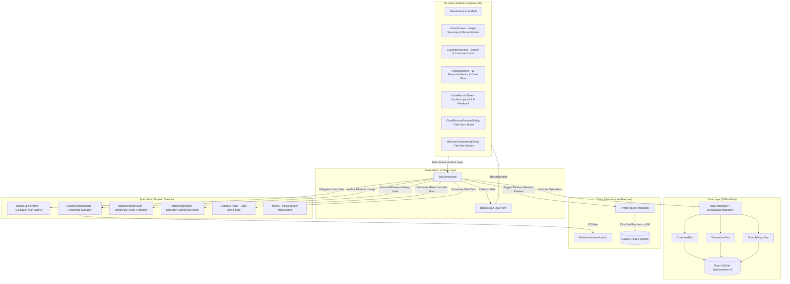
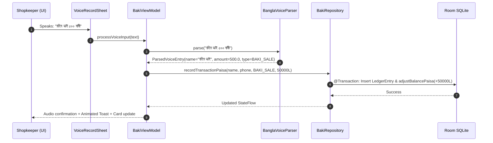

# Architecture Guide — Baki Bondhu (বাকী বন্ধু)

> **Owner / Engineering**: DevCenterPoint ([devcenterpoint.com](https://devcenterpoint.com))  
> **App Nickname**: `com.dcp.bakibondhu`  
> **Package ID**: `com.aistudio.bakibondhu.kxdznp`  
> **Core Promise**: "আপনার দোকানের হিসাব, এখন শুধু মুখে বললেই।" *(Your shop's ledger, simply by speaking)*

---

## 1. Architectural Philosophy & High-Level Design

Baki Bondhu is built according to **Modern Android Architecture (MVI / MVVM)** adhering strictly to the **Offline-First Reactive Ledger Pattern**. In retail grocery, stationery, and small-vendor environments across Bangladesh, cellular connectivity is frequently intermittent or unavailable. Therefore, the application is designed such that:

1. **Local SQLite is the Single Source of Truth**: All customer records, ledger entries, and merchant settings are written and queried directly from local Room tables. The app never blocks UI interactions waiting for a network handshake.
2. **Deterministic Minor Currency Units (Paisa)**: All financial amounts are stored as integer `Long` values representing minor units ($1\text{ BDT} = 100\text{ Paisa}$). IEEE 754 floating-point drift is completely eliminated.
3. **Reactive Unidirectional Data Flow (UDF)**: ViewModels expose immutable `StateFlow` streams that Compose screens collect. User interactions trigger discrete ViewModel intents that execute atomic Room `@Transaction` operations.
4. **Asynchronous Non-Blocking Synchronization**: Cloud Firestore sync runs silently in the background, chunked in batches of 400 operations, using stable UUID-based document IDs.

---

## 2. High-Level Component Architecture

---

## 3. Core Modules & Component Responsibilities

### 3.1 Presentation Layer (`com.example.ui`)
- **Jetpack Compose Material 3 Expressive**:
  - `HomeScreen.kt`: Dynamic top metrics (Total Due, Today's Credit, Today's Collection), quick action buttons, and recent transaction timeline.
  - `CustomersScreen.kt`: Searchable customer cards with real-time balance badges, overdue status flags, and 1-tap WhatsApp reminder triggers.
  - `ReportsScreen.kt`: Comprehensive dashboard computing 11 core financial metrics directly from Room SQLite with Saturday-aligned commercial retail cycles.
  - `VoiceRecordSheet.kt`: Oscilloscope audio visualization, transcribed speech review, missing amount warning banners, and rapid amount chips.
  - `CloudRestorePreviewDialog.kt`: Pre-restore safety modal comparing local vs. cloud counts with Smart Merge and Full Replace options.
- **`BakiViewModel.kt`**:
  - Centralized presentation coordinator managing UI state, coroutine scopes (`viewModelScope`), voice manager events, authentication callbacks, and cloud sync jobs.

### 3.2 Data Layer (`com.example.data`)
- **`AppDatabase.kt`**:
  - Room database configuration at version 5. Enforces WAL (Write-Ahead Logging), SQLite foreign keys, and indexes.
  - Migrated cleanly from version 4 via `MIGRATION_4_5` without data destruction.
- **Entities**:
  - `CustomerEntity`: Unique ID, UUID, Name, Phone, `balancePaisa` (`Long`), `isArchived`, `syncStatus`, `updatedAt`.
  - `LedgerEntryEntity`: Unique ID, UUID, Customer ID, Customer UUID, Type (`BAKI_SALE`, `REPAYMENT`, `CASH_SALE`), `amountPaisa` (`Long`), `isDeleted`, `syncStatus`, `timestamp`.
  - `ShopSettingsEntity`: Single-row singleton storing shop name, owner name, bKash number, Nagad number, language preference (`bn`/`en`), and audio readback preference.
- **Repositories**:
  - `BakiRepository` / `DefaultBakiRepository`: Atomic repository wrapping Room DAOs inside `@Transaction` blocks. Updates customer balances atomically alongside transaction insertions.
  - `FirestoreSyncRepository`: Cloud synchronizer handling chunked batch writes (chunks of 400), pre-restore metadata inspection, and two-way mapping.

### 3.3 Domain & Voice Intelligence Layer (`com.example.voice`, `com.example.util`)
- **`BanglaVoiceParser.kt`**:
  - Deterministic colloquial Bengali regex parser that extracts customer name, transaction type, and amounts from speech transcripts.
  - Handles Bengali numerals (`০-৯`), ASCII digits, and verbal quantity expressions (*এক হাজার*, *পাঁচশো*, *দেড় হাজার*, etc.).
  - Enforces zero amount hallucination safety: flags `isAmountMissing = true` if no explicit monetary quantity was detected.
- **`Money.kt`**:
  - Domain value class wrapping `Long` Paisa. Guarantees exact currency conversions, comparison operations, and bilingual formatting with non-breaking spaces (`৳\u00A0`).
- **`GoogleAuthManager.kt`**:
  - Jetpack Credential Manager bridge implementing `GetSignInWithGoogleOption`. Unwraps Activity contexts safely and provides seamless Guest mode fallback.

---

## 4. Unidirectional Data Flow (UDF) & State Architecture

---

## 5. Offline-First Resilience & Error Handling

1. **Zero Network Dependence for Core Workflows**:
   - Creating customers, recording credit, taking repayments, searching records, and calculating daily reports function 100% offline.
2. **Tombstone Soft Deletions**:
   - Deleting a transaction flags `isDeleted = 1` and recalculates customer balance without dropping records, enabling reliable two-way cloud sync conflict resolution.
3. **Foreign Key Integrity**:
   - `LedgerEntryEntity` references `CustomerEntity` with `onDelete = ForeignKey.RESTRICT`. Customers with active ledger records cannot be inadvertently orphaned.
4. **Atomic In-Memory Rollbacks**:
   - Repository operations are encapsulated within SQLite transactions. A failure during ledger entry insertion automatically rolls back any customer balance adjustment.
