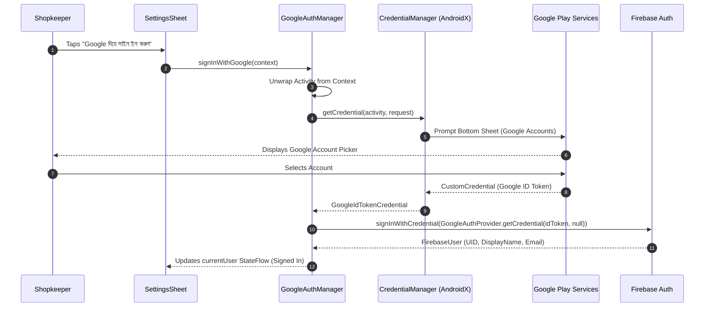

# Authentication Architecture — Baki Bondhu (বাকী বন্ধু)

> **Owner / Engineering**: DevCenterPoint ([devcenterpoint.com](https://devcenterpoint.com))  
> **App Nickname**: `com.dcp.bakibondhu`  
> **Framework**: AndroidX Credential Manager (`androidx.credentials`) + Firebase Authentication  
> **Primary Identity Provider**: Google Identity Services (`googleid`)

---

## 1. Authentication Philosophy

For Bangladeshi neighborhood retail merchants (*Mudi Dokan*, tea stalls, medicine pharmacies), friction during app launch is the #1 cause of abandonment. Shopkeepers cannot afford to solve CAPTCHAs, wait for SMS OTPs, or remember complex passwords when a queue of customers is waiting at the counter.

Therefore, Baki Bondhu enforces two fundamental principles:

1. **First-Class Guest Mode (Offline by Default)**:
   - On first launch, the app immediately enters fully functional Guest mode.
   - All ledger, customer, voice parsing, reports, receipt generation, and WhatsApp reminder features work without requiring an account or Google sign-in.
   - No data is gated or locked behind a login wall.
2. **Frictionless 1-Tap Google Sign-In (For Cloud Backup Only)**:
   - Google Sign-In is presented inside Settings as an optional capability to secure data to the cloud.
   - Utilizes the modern **Android Credential Manager API** (`androidx.credentials`), eliminating legacy `GoogleSignInClient` and deprecated web flows.

---

## 2. Credential Manager Architecture



---

## 3. Implementation Details

### 3.1 Web Client Configuration
The Google OAuth 2.0 Web Client ID is configured in `app/src/main/res/values/strings.xml`:
```xml
<string name="default_web_client_id">704564450702-d0ns15b9aipnslup9cvgos3qvp15chmq.apps.googleusercontent.com</string>
```
At runtime, `GoogleAuthManager` retrieves this resource dynamically. If the resource is missing or empty, it throws an explicit, actionable exception rather than silently failing.

### 3.2 Secure Activity Context Unwrapping
Credential Manager requires an active `Activity` context to attach its bottom sheet window token. Jetpack Compose often wraps Activity instances within nested `ContextWrapper` layers. `GoogleAuthManager` provides safe recursive unwrapping:

```kotlin
private fun unwrapActivity(context: Context): Activity? {
    var current = context
    while (current is ContextWrapper) {
        if (current is Activity) return current
        current = current.baseContext
    }
    return null
}
```

### 3.3 Constructing `GetSignInWithGoogleOption`
To prevent replay attacks and ensure compatibility with modern Android 14+ / Google Play Services:

```kotlin
val rawNonce = UUID.randomUUID().toString()
val bytes = rawNonce.toByteArray()
val md = MessageDigest.getInstance("SHA-256")
val digest = md.digest(bytes)
val hashedNonce = digest.fold("") { str, it -> str + "%02x".format(it) }

val googleIdOption = GetSignInWithGoogleOption.Builder(serverClientId)
    .setFilterByAuthorizedAccounts(false) // Allows signing in with any account on the device
    .setNonce(hashedNonce)
    .build()

val request = GetCredentialRequest.Builder()
    .addCredentialOption(googleIdOption)
    .build()
```

### 3.4 Cancellation & Error Classification
User cancellations (e.g., closing the Google bottom sheet or tapping outside) must never trigger jarring error banners or crash states. `GoogleAuthManager` traps cancellation errors gracefully:

```kotlin
when (e) {
    is GetCredentialCancellationException -> {
        // User closed the sheet intentionally; no user-facing error toast
        Result.failure(GoogleSignInCancelledException("Sign-in cancelled by user"))
    }
    is NoCredentialException -> {
        Result.failure(Exception("ডিভাইসে কোনো গুগল একাউন্ট পাওয়া যায়নি"))
    }
    else -> {
        Result.failure(e)
    }
}
```

---

## 4. Firebase Authentication Lifecycle & Persistence

Once the Google ID token is validated by `FirebaseAuth.signInWithCredential`, the authentication state persists across app restarts using Firebase's local token cache.

- **State Observation**: `GoogleAuthManager` maintains a `StateFlow<FirebaseUser?>` that emits `null` when in Guest mode, or the authenticated `FirebaseUser` object when signed in.
- **Sign-Out Protocol**:
  ```kotlin
  suspend fun signOut() {
      try {
          credentialManager.clearCredentialState(ClearCredentialStateRequest())
      } catch (e: Exception) {
          Log.w("GoogleAuthManager", "Clear credential state failed", e)
      }
      firebaseAuth.signOut()
      _currentUser.value = null
  }
  ```
  Signing out clears both Firebase session tokens and Android Credential Manager saved states, returning the merchant instantly to Guest mode without modifying their local Room database records.
