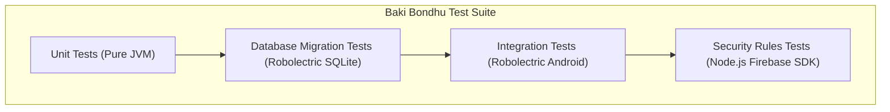

# QA & Automated Testing Strategy — Baki Bondhu (বাকী বন্ধু)

> **Owner / Engineering**: DevCenterPoint ([devcenterpoint.com](https://devcenterpoint.com))  
> **Test Frameworks**: JUnit 4, Robolectric 4.14.1, Kotlin Coroutines Test  
> **Target SDK Configuration**: Android API 34 (Robolectric Sandbox)

---

## 1. Quality Assurance Philosophy

Because Baki Bondhu manages actual financial credit and debt ledgers for small shopkeepers, testing correctness is prioritized over test vanity metrics. In particular:

1. **Monetary Calculations Must Never Drift**: Floating point arithmetic is strictly forbidden for financial calculations. Tests verify integer-level Paisa determinism.
2. **Zero Data Loss on Migration**: Migrating from previous versions of the database must preserve every single customer record, historical ledger entry, and balance without truncation or corruption.
3. **Voice Parsing Must Never Hallucinate Amounts**: If a customer says *"রহিম সাহেব বাকি নিলেন"* without an amount, the app must never guess or default to 0. It must flag the missing amount and prompt for clarification.
4. **Offline Capability Must Be Fully Testable**: Core DAOs and repositories are testable in-memory without network connectivity.

---

## 2. Test Suite Catalog



### 2.1 Pure JVM Unit Tests
- **`MoneyTest.kt`**:
  - `conversion from BDT double to Paisa is exact without floating drift`: Asserts that `1250.50` BDT converts exactly to `125050L` Paisa, eliminating floating point noise like `1250.5000000000002`.
  - `arithmetic operations are deterministic and integer based`: Validates addition, subtraction, and multiplication across `Money` instances.
  - `bilingual formatting uses non-breaking space and correct numerals`: Validates that Bengali formatted strings (`৳\u00A0১,৫০০`) contain non-breaking spaces (`\u00A0`) and proper comma placement.
- **`BanglaVoiceParserTest.kt`**:
  - `parses basic credit sale with Bengali digits`: *"রহিম ৪৫০ বাকী"* $\rightarrow$ `Rahim`, `450.0`, `BAKI_SALE`.
  - `parses repayment with verbal word numbers`: *"সুমন পাঁচশো পরিশোধ"* $\rightarrow$ `Sumon`, `500.0`, `REPAYMENT`.
  - `parses compound spoken amounts`: *"করিম দেড় হাজার টাকা জমা"* $\rightarrow$ `1500.0`, *"আড়াই হাজার"* $\rightarrow$ `2500.0`.
  - `strips Bengali case markers`: Validates that *"রহিমকে"*, *"করিমের"*, *"সুমনরে"* resolve cleanly to root names *"রহিম"*, *"করিম"*, *"সুমন"*.
  - `zero amount hallucination safety`: Flags `isAmountMissing = true` when no amount is detected in *"সালাম ভাই বাকী নিলেন"*.
- **`ExampleUnitTest.kt`**:
  - Bengali digit conversion (`toBanglaDigits`, `toAsciiDigits`).
  - SMS template generation (`BakiStrings.buildSmsText`).

### 2.2 Database Migration Tests (`DatabaseMigrationTest.kt`)
- `migration from v4 to v5 converts double to paisa and adds uuid columns without data loss`:
  1. Instantiates a raw SQLite database matching the Version 4 schema.
  2. Seeds test customer records (`balance = 1250.50`) and transactions (`amount = 1250.50`).
  3. Executes `DatabaseMigrations.MIGRATION_4_5.migrate(db)`.
  4. Queries migrated v5 tables to verify:
     - `balancePaisa` equals `125050L`.
     - Valid 32-character hexadecimal UUIDs are generated for customers and transactions.
     - `customerUuid` in `LedgerEntries` correctly references parent customer UUID.
     - Foreign key constraint is upgraded to `ON DELETE RESTRICT`.
     - `syncStatus` is initialized to `'PENDING_SYNC'` and `isDeleted = 0`.

### 2.3 Integration & Robolectric Tests (`ExampleRobolectricTest.kt`)
- `Room database initializes Customers and LedgerEntries tables`: Tests in-memory database creation and DAO table existence.
- `BakiRepository abstracts database operations and tracks offline-first sync state`: Verifies transition from `SYNCED` to `PENDING_SYNC` upon local transaction entry.
- `OverdueHelper calculates Due Soon, Overdue, and Critical tiers`: Tests customer debt aging buckets (0–2 days, 3–7 days, >7 days).
- `DateRangeHelper filters transactions by daily, weekly, and custom range`: Validates transaction bucketing with Saturday-aligned commercial retail start-of-week.
- `EndOfDaySummary calculates net cash flow and cash drawer reconciliation`: Tests cash in drawer formula:
  $$\text{Cash in Drawer} = \text{Repayments} + \text{Cash Sales}$$
- `DigitalReceiptHelper generates properly structured digital receipt`: Validates merchant shop name, owner contact, bKash, Nagad, and DevCenterPoint attribution.
- `formatWhatsAppPhone correctly standardizes Bangladeshi phone numbers`: Tests conversion of `017...`, `+88017...`, `88017...`, and formatted phone numbers with spaces/dashes into `88017...`.

---

## 3. Running Automated Tests

### 3.1 Run All Unit & Migration Tests
```bash
./gradlew testDebugUnitTest
```

### 3.2 Run Specific Test Suites
```bash
# Pure JVM Money tests
./gradlew testDebugUnitTest --tests "com.example.MoneyTest"

# Bengali Voice Parser tests
./gradlew testDebugUnitTest --tests "com.example.BanglaVoiceParserTest"

# Database v4 to v5 migration tests
./gradlew testDebugUnitTest --tests "com.example.DatabaseMigrationTest"
```

### 3.3 Robolectric Configuration Guidelines
Robolectric tests in this project are configured with:
```kotlin
@RunWith(RobolectricTestRunner::class)
@Config(sdk = [34])
```
*Note: Because Android compileSdk is set to 36, pinning Robolectric to API 34 avoids `DefaultSdkProvider` lookup failures on unreleased shadows while guaranteeing robust testing of all Android Framework features.*
