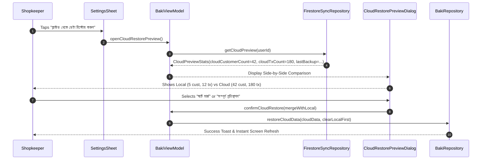

# Cloud Synchronization & Conflict Resolution — Baki Bondhu (বাকী বন্ধু)

> **Owner / Engineering**: DevCenterPoint ([devcenterpoint.com](https://devcenterpoint.com))  
> **Backend Service**: Google Cloud Firestore  
> **Security Model**: Zero-Trust Per-User Isolation (`request.auth.uid == userId`)

---

## 1. Cloud Architecture & Document Layout

Baki Bondhu utilizes **Google Cloud Firestore** as a secondary backup and cross-device restoration medium. The local Room SQLite database remains the primary operational data store.

### 1.1 Hierarchical Path Layout
All cloud documents are isolated within the authenticated merchant's UID tree:

```
/users/{userId}
   ├── (root document: metadata, lastBackupAt, shopSettings)
   ├── customers/{customerUuid}
   │     ├── uuid: String
   │     ├── name: String
   │     ├── phone: String
   │     ├── balancePaisa: Long
   │     ├── isArchived: Boolean
   │     ├── updatedAt: Long
   │     └── dueDate: Long?
   └── transactions/{transactionUuid}
         ├── uuid: String
         ├── customerUuid: String
         ├── customerName: String
         ├── type: String ("BAKI_SALE", "REPAYMENT", "CASH_SALE")
         ├── amountPaisa: Long
         ├── note: String?
         ├── originalSpokenText: String?
         ├── timestamp: Long
         ├── isDeleted: Boolean
         └── updatedAt: Long
```

### 1.2 Zero-Trust Firestore Security Rules (`firestore.rules`)
```javascript
rules_version = '2';
service cloud.firestore {
  match /databases/{database}/documents {
    match /users/{userId} {
      allow read, write: if request.auth != null && request.auth.uid == userId;

      match /customers/{customerId} {
        allow read, write: if request.auth != null && request.auth.uid == userId;
      }

      match /transactions/{transactionId} {
        allow read, write: if request.auth != null && request.auth.uid == userId;
      }
    }
  }
}
```
No user can query, read, or modify another merchant's ledger entries.

---

## 2. Chunked Batch Writing Pattern

Cloud Firestore enforces a strict quota of **maximum 500 write operations per atomic batch**. If a merchant has 1,200 transactions, a naive batch write crashes with `INVALID_ARGUMENT: too many writes in batch`.

`FirestoreSyncRepository` chunks collections into **safe blocks of 400 operations**:

```kotlin
customers.chunked(400).forEach { chunk ->
    val batch = firestore.batch()
    chunk.forEach { customer ->
        val docRef = userDoc.collection("customers").document(customer.uuid)
        batch.set(docRef, customerToMap(customer))
    }
    batch.commit().await()
}

transactions.chunked(400).forEach { chunk ->
    val batch = firestore.batch()
    chunk.forEach { tx ->
        val docRef = userDoc.collection("transactions").document(tx.uuid)
        batch.set(docRef, transactionToMap(tx))
    }
    batch.commit().await()
}
```

---

## 3. Pre-Restore Safety Inspection (`CloudRestorePreviewDialog`)

In naive ledger apps, tapping "Restore from Cloud" immediately wipes local data or causes unrecoverable conflicts without user consent.

Baki Bondhu implements a mandatory **Two-Phase Inspection Protocol**:



### 3.1 Comparison Metrics Presented to Merchant
The `CloudRestorePreviewDialog` presents clear, non-technical comparative metrics:
- **ক্লাউড ব্যাকআপ তথ্য**: Last backup timestamp formatted in Bengali date/time.
- **গ্রাহক সংখ্যা**: Local customer count vs. Cloud customer count.
- **লেনদেন সংখ্যা**: Local transactions vs. Cloud transactions.

---

## 4. Conflict Resolution Modes

### Mode A: Smart Merge (স্মার্ট মার্জ — Recommended)
- Matches records by unique UUID.
- If a cloud record matches an existing local UUID, the local record is updated with the latest cloud state.
- If a record exists locally but is missing from the cloud (e.g., transactions recorded offline before restoring), the local record is **preserved**.
- Customer balances are atomically recalculated from the unified ledger entries.

### Mode B: Full Replace (সম্পূর্ণ প্রতিস্থাপন — New Device Migration)
- Used when a merchant sets up a brand new phone and wishes to discard initial test data.
- Executes within an atomic Room `@Transaction`:
  ```sql
  DELETE FROM Customers;
  DELETE FROM LedgerEntries;
  ```
- Imports the entire cloud snapshot cleanly, re-establishing customer IDs and foreign key links.
